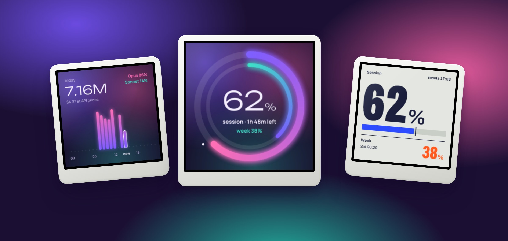
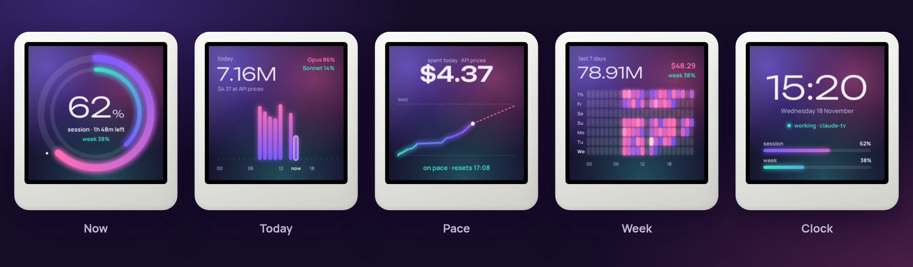
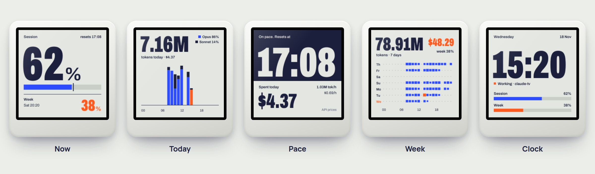

<h1 align="center">claude-tv</h1>

<p align="center">Your Claude Code usage, glowing on a tiny desk clock.</p>

<p align="center">
  <a href="https://github.com/svitiashchuk/claude-tv/actions/workflows/test.yml"></a>
  
  <a href="LICENSE"></a>
  
  
</p>

<p align="center"></p>

A small Go program on your laptop reads your Claude Code usage, draws it as pretty 240×240
pictures, and sends them to a GeekMagic SmallTV over your
Wi‑Fi. **The clock keeps its original firmware.** Nothing to flash, nothing to solder.

## Quick start

```sh
go install github.com/svitiashchuk/claude-tv/cmd/claude-tv@latest
claude-tv -device 192.168.1.50     # your clock's IP, shown on its screen at boot
```

Open <http://127.0.0.1:8787> to see every screen live and switch themes.
No clock yet? Run `claude-tv -demo` and just use the preview page.

Works with the stock **SmallTV Ultra** and **SmallTV Pro** firmware, the **SD_PRO**-style
firmware and the older **Smart Weather Clock** firmware. claude-tv works out which one you have.
If yours isn't recognised, run `claude-tv probe -device <ip>` and
[open an issue](https://github.com/svitiashchuk/claude-tv/issues) with the output.

## Two themes

**Aurora** (default): soft light on deep plum.



**Signal**: a bold Swiss poster, readable from across the room. `claude-tv -theme signal`



| Screen | What it tells you |
|---|---|
| **Now** | How much of your 5‑hour session and your week you've used, and when it resets |
| **Today** | Tokens per hour, today's total and its API-price equivalent |
| **Pace** | Whether you'll hit the session limit, and at what time |
| **Week** | When you worked over the last 7 days |
| **Clock** | The time, and whether Claude Code is busy right now |

## Is it safe?

- **Everything stays on your laptop.** Usage is read from Claude Code's own files in
  `~/.claude`. The only outside call is to Anthropic for your plan limits, the same numbers
  claude.ai shows under *Settings → Usage*. Turn it off with `-limits=false`.
- **Your login is read, never changed.** claude-tv reads Claude Code's token (the Keychain on
  macOS, `~/.claude` on Linux) and never refreshes or rewrites it. On first run, macOS may
  ask whether claude-tv can use the item.
- **The clock only receives pictures.** Your own photos on it are left alone.
- **Gentle on the clock.** A screen is only re-sent when it changes, at most once a minute.
- **Tip:** block the clock from the internet in your router. claude-tv doesn't need it,
  and it draws the time from your laptop.

## Make your own theme

A theme is one Go file in `internal/render/`. It gets a screen name and your usage, and returns a 240×240 image:

```go
package render

import (
	"image"

	"github.com/fogleman/gg"
	"github.com/svitiashchuk/claude-tv/internal/usage"
)

type mono struct{}

func init() { register(mono{}) }

func (mono) Name() string { return "mono" }

func (mono) Render(screen string, s *usage.Snapshot) image.Image {
	dc := gg.NewContext(Size, Size)
	dc.SetHexColor("#000000")
	dc.Clear()

	switch screen {
	case "now":
		text(dc, pct(s.Limits.Session.Util)+"%", "Unbounded-Light", 64, hex("#FFFFFF"), 120, 110, 0.5, 0.5)
		text(dc, "session", "Manrope-Bold", 12, hex("#888888"), 120, 160, 0.5, 0.5)
	default:
		text(dc, fmtTokens(s.Today.Tokens), "Unbounded-Light", 40, hex("#FFFFFF"), 120, 120, 0.5, 0.5)
	}
	return dc.Image()
}
```

Then preview it without a clock:

```sh
go run ./cmd/claude-tv render -demo -theme mono -out screens/
go test ./...      # draws every screen of every theme, including with no data
```

Everything you can draw is in [`usage.Snapshot`](internal/usage/snapshot.go). For glow,
gradient rings, and charts, borrow from [`aurora.go`](internal/render/aurora.go). Fonts live
in `internal/render/fonts/`; drop in any `.ttf` and use its file name.

<details>
<summary><b>All options</b></summary>

| Flag | Default | |
|---|---|---|
| `-device` | | clock's IP; without it only the preview page runs |
| `-theme` | `aurora` | `aurora` or `signal` |
| `-screens` | `now,today,pace,week,clock` | which screens rotate, in order |
| `-rotate` | `20s` | how long each screen stays up |
| `-min-upload` | `60s` | re-send a changed screen at most this often |
| `-brightness` | `-1` | set brightness 0–100 on start; `-1` leaves it alone |
| `-firmware` | `auto` | force `ultra`, `pro`, `sdpro` or `legacy` if detection guesses wrong |
| `-limits` | `true` | `false`: never contact Anthropic |
| `-demo` | | sample data |

Run it on login with [`contrib/claude-tv.service`](contrib/claude-tv.service) (systemd user service).
</details>

<details>
<summary><b>Good to know</b></summary>

- Cost is what your usage would cost at API prices, which is useful for comparison but isn't your subscription bill.
- Claude Code deletes old transcripts, so claude-tv keeps its own hourly totals in `~/.local/share/claude-tv/`.
- Only the stock Ultra firmware can switch between stored pictures. The others show one picture at a time, so every screen change is an upload. Use fewer `-screens` or a longer `-rotate` to spare their flash.
- The firmware endpoints follow the device reports collected by [geekmagic-hacs](https://github.com/adrienbrault/geekmagic-hacs) and [geekmagic-stats](https://docs.rs/crate/geekmagic-stats/0.1.0/source/device-protocol.md). Thank you!
</details>

## License

[MIT](LICENSE). Fonts (Unbounded, Manrope, Archivo) are under the SIL Open Font License.
Not affiliated with Anthropic or GeekMagic.
